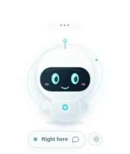
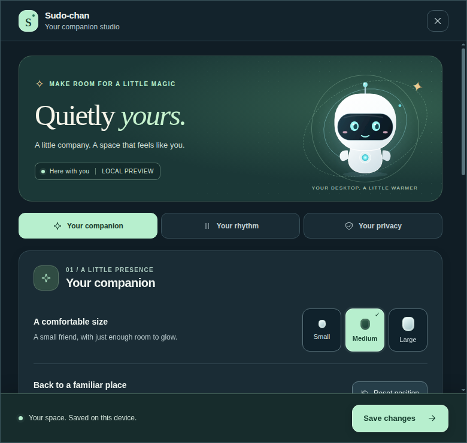
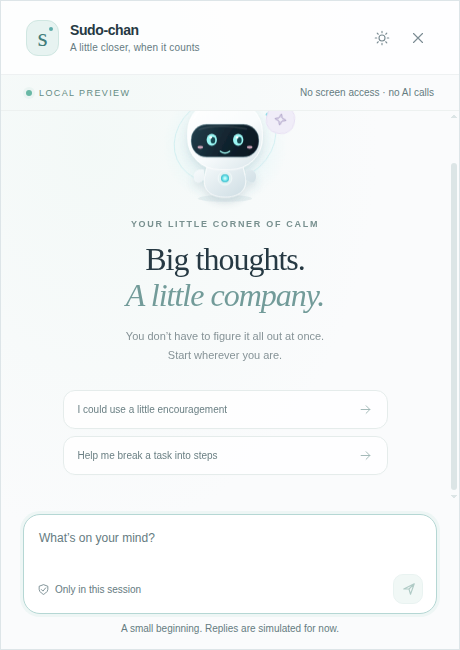

# Sudo-chan Desktop

Phase 1: a local Electron companion, a transparent overlay, mock chat and settings. The settings studio uses dark teal surfaces, mint controls, readable text and a live companion-size preview. Chat uses a light surface. There is no screen capture, microphone access, AI connection, account system or payment flow.

## Develop

Use Node.js 22.12+ (Node 24 recommended) and npm. Run inside `desktop/`:

```bash
npm ci
npm run dev
```

Vite binds only to `127.0.0.1:5178`. React updates live; restart development after main/preload changes. Environment-file loading is disabled. This project does not read the website's environment files.

```bash
npm run build       # typecheck, main/preload build, renderer build
npm test            # boundary validation and display-position tests, after build
npm start           # run the built Electron app
npm run package     # create an unpacked app in release/ (no publishing)
```

`package:linux`, `package:win` and `package:mac` create AppImage, NSIS and DMG respectively. Build and sign on each target OS before distributing; macOS signing/notarization and Windows signing are not configured.

## Layout

- `src/main/`: windows, tray, native shortcuts, persistence, IPC authorization.
- `src/preload/`: sandbox-compatible, bundled CommonJS bridge; no raw IPC exposed.
- `src/renderer/`: React views, SVG companion and styles.
- `src/shared/`: typed IPC contract, settings validation and display geometry.
- `scripts/`: Vite/Electron development and production builds.

The landing page remains a separate application. Run its npm commands from the repository root.

## Use

Drag the three dots above the companion. Click to greet, double-click to open chat, or use the dock button. The default chat shortcut is `Control+Space`; change it if your desktop input method already uses it. Escape hides the focused chat or settings panel; it never hides the companion, even if held while focus returns to the bot. Use **Hide companion** in the tray to hide the bot explicitly. Chat hides on blur, and closing windows keeps the tray running. Use **Quit Sudo-chan** to exit fully.

Launch at login is available in packaged builds. Linux writes a user-level freedesktop autostart entry only when you enable the setting; disabling it removes that entry. Windows/macOS use the native login-item API. Keep an AppImage at its permanent path before enabling this. Development builds leave login settings alone.

Settings and position persist in Electron's per-user application directory through `electron-store`. Chat is memory-only, capped at 100 messages and cleared on Quit. Pause is a preview state, not a screen-capture control.

## Linux / GNOME

Linux defaults to software rendering because GPU acceleration caused repeated GPU-process crashes on the test laptop. The SVG/CSS companion does not require WebGL. Run with `--hardware-acceleration` to opt into GPU rendering on a compatible machine; `--disable-gpu` always takes precedence. Fully quit the previous instance before changing rendering flags.

Linux defaults to the `--ozone-platform=x11` compatibility backend (requires XWayland on Wayland sessions). The entrypoint relaunches once with this command-line argument before loading any windows: Electron chooses its display backend before app JavaScript runs, so setting it later can produce blank windows. `npm run dev` supplies the argument directly. `npm start -- --native-wayland` opts into experimental native Wayland; transparent-area click-through and positioning are not guaranteed there. Explicit `--ozone-platform` arguments take precedence. The X11 overlay uses native window regions for the bot, drag grip, dock and speech bubble. These controls always accept input; the outside corners pass clicks through without relying on cursor polling.

GNOME may require its AppIndicator/KStatusNotifier extension to display tray icons. The on-bot settings button also provides Quit, so the app remains recoverable without a tray icon. A shortcut conflict returns a friendly error and preserves the previous working shortcut.

## Security

All windows use `contextIsolation: true`, `nodeIntegration: false`, `sandbox: true`, denied permissions and blocked navigation/popups. Production CSP allows only local scripts/styles/images, with network connections disabled. IPC checks the known window, main frame and exact document before validating payloads. Vite development permits only its local HTTP/WebSocket connection and injected development styles.

References: [Electron security](https://www.electronjs.org/docs/latest/tutorial/security), [window interaction behavior](https://www.electronjs.org/docs/latest/tutorial/custom-window-interactions), [global shortcuts](https://www.electronjs.org/docs/latest/api/global-shortcut).

## Manual acceptance checklist

- [ ] Overlay renders transparently, stays above other apps and skips the taskbar.
- [ ] Transparent corners pass clicks through; bot, grip and dock remain interactive.
- [ ] Drag, restart and verify position; unplug a monitor and confirm recovery.
- [ ] Tray Show/Hide, pause, chat, settings and Quit work.
- [ ] Shortcut opens chat; Escape/blur dismiss; occupied shortcut fails gracefully.
- [ ] Mock chat renders user input as text; bot becomes happy briefly.
- [ ] Size/settings persist; reset position returns bottom-right.
- [ ] Reduced motion suppresses animation; keyboard focus remains visible.
- [ ] Settings scroll smoothly, section links work and scroll motion stays subtle.
- [ ] Second launch reuses the existing process; Quit leaves no windows/process.
- [ ] Verify installers, autostart and native behavior separately on each OS.

See `TEST_REPORT.md` for what was actually tested in this workspace.

## Screenshots

Packaged-app smoke-test captures:






